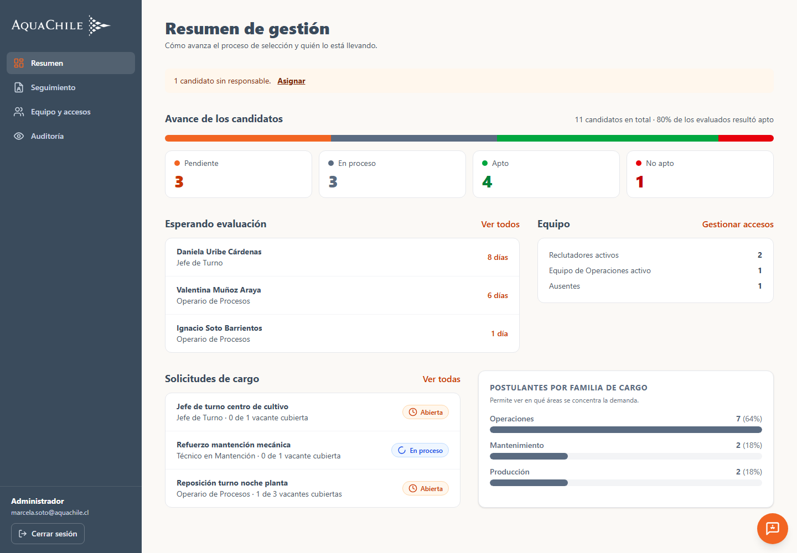
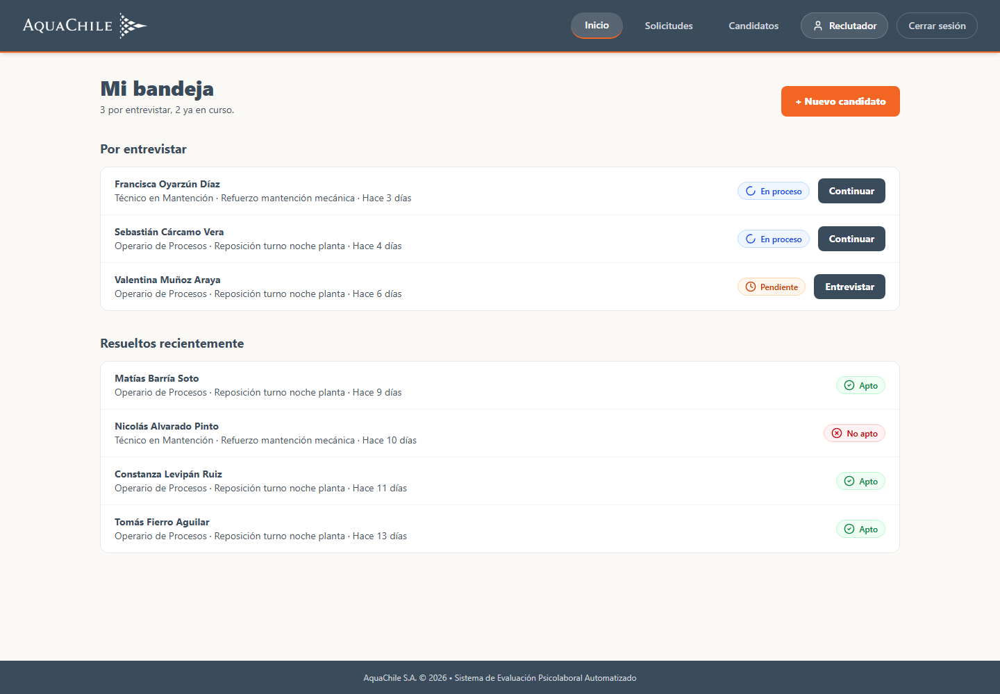
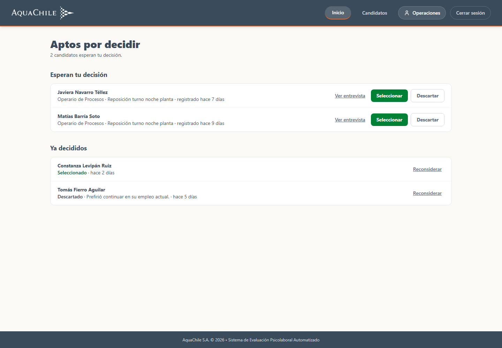
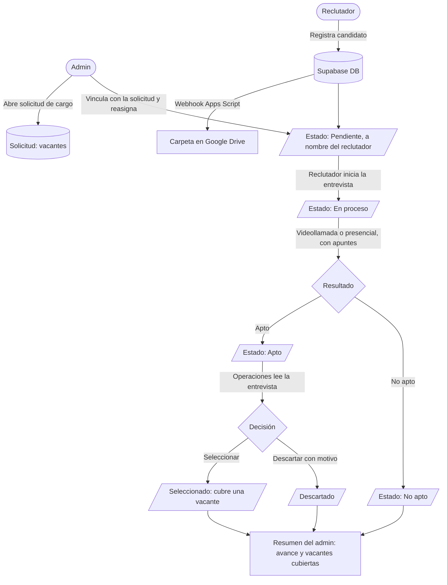

# AquaChile · Gestión y Evaluación Psicolaboral (MVP)


## 🏢 1. Introducción y Guía de Instalación

### ¿Qué es AquaChile y qué resuelve este MVP?

**AquaChile** es una compañía de producción acuícola y salmonera con operaciones desde la Región de Los Lagos hasta Magallanes. Este MVP es una aplicación web de **Gestión y Evaluación Psicolaboral** para el área de Reclutamiento y Selección (R&S).

**Problemática:** el proceso se gestionaba de forma manual y dispersa entre **MS Forms, planillas Excel, Planner y OneDrive**. Eso generaba información duplicada, seguimiento difícil y datos sensibles repartidos en varias herramientas.

**Solución:** una plataforma web **centralizada y segura**, con **una interfaz distinta para cada rol**, que permite:

- Registrar candidatos y solicitudes de cargo en una base de datos única (Supabase).
- Crear automáticamente una carpeta de Google Drive por candidato.
- **Asignar** cada candidato a un reclutador responsable y a una solicitud de cargo.
- **Entrevistar** (por videollamada o presencial) con apuntes que se guardan solos, y decidir *Apto / No apto*.
- Entregar a Operaciones los candidatos aptos para que **seleccione o descarte** con un motivo.
- Dar a la jefatura un resumen de gestión: avance del proceso, vacantes cubiertas y carga del equipo.
- **Gestionar al equipo**: invitar por correo, marcar ausencias y revocar accesos sin perder el historial.
- Controlar el acceso por roles, con restricciones aplicadas también en la base de datos.

### Guía de instalación (computadora nueva)

1. **Requisitos previos:** [Node.js](https://nodejs.org/) **18 o superior**, [Git](https://git-scm.com/) y npm (incluido con Node.js). Para las pruebas y las capturas se necesita además Google Chrome.
2. **Clonar el repositorio y entrar a la carpeta del frontend:**
   ```bash
   git clone https://github.com/donMixho/AquaChile.git
   cd AquaChile/frontend
   ```
3. **Instalar dependencias:**
   ```bash
   npm install
   ```
4. **Configurar las variables de entorno:** crear el archivo `.env` dentro de `frontend/` con:
   ```env
   VITE_SUPABASE_URL=https://<tu-proyecto>.supabase.co
   VITE_SUPABASE_ANON_KEY=<tu-anon-key>
   VITE_GOOGLE_DRIVE_WEBHOOK_URL=https://script.google.com/macros/s/<id>/exec
   ```
   > `VITE_GOOGLE_DRIVE_WEBHOOK_URL` es opcional: sin ella el sistema funciona igual, pero no crea carpetas en Drive. El Web App de Apps Script debe estar desplegado con acceso **"Cualquier persona"**.
5. **Preparar la base de datos:** en el SQL Editor de Supabase, ejecutar **uno por uno y en este orden**. Se pega el *contenido* de cada archivo (no su nombre) y cada uno debe terminar en «Success»:
   1. `docs/schema.sql`
   2. `docs/migracion_estado_candidatos.sql`
   3. `docs/migracion_drive_folder_url.sql`
   4. `docs/migracion_solicitudes.sql`
   5. `docs/politicas_rls_candidatos.sql`
   6. `docs/asignar_roles_usuarios.sql` (asigna el rol de cada usuario en `app_metadata`)
   7. `docs/migracion_perfiles.sql` (equipo: rol y estado de cada persona; endurece las políticas de candidatos)
   8. `docs/migracion_asignacion.sql` (responsable y solicitud de cada candidato)
   9. `docs/migracion_evaluaciones.sql` (apuntes y modalidad de las entrevistas)
   10. `docs/migracion_decision_operaciones.sql` (decisión de Operaciones sobre los aptos)

   Después de ejecutarlos, cada usuario debe cerrar sesión y volver a entrar para renovar su token. Si falta alguna migración, la pantalla afectada lo avisa con el nombre exacto del archivo que hay que ejecutar.
6. **Gestión del equipo (invitar y bloquear personas):** requiere desplegar la Edge Function, porque usa la clave `service_role` que nunca debe estar en el navegador:
   ```bash
   supabase functions deploy admin-usuarios
   supabase secrets set SITE_URL=https://tu-dominio.cl
   ```
   Además, en Supabase > Authentication > URL Configuration, agregar `https://tu-dominio.cl/definir-contrasena` a las URL de redirección permitidas.
7. **Iniciar el servidor de desarrollo:**
   ```bash
   npm run dev
   ```
   Vite sirve la aplicación en `http://localhost:5173`. Si se edita `.env`, hay que reiniciar este comando.

## 📁 2. Estructura del Proyecto

```text
frontend/
├── README.md
├── index.html
├── package.json
├── vite.config.js
├── tailwind.config.js         # tokens de color aqua-*
├── postcss.config.js
├── eslint.config.js
├── karma.conf.js              # Karma + Jasmine + cobertura
├── docker-compose.yml
├── supabase/
│   └── functions/
│       └── admin-usuarios/    # Edge Function: invitar y bloquear personas (service_role)
├── scripts/
│   └── vista-previa/          # genera las capturas del README con datos de muestra (npm run capturas)
├── .env                       # variables VITE_* (no se versiona)
├── public/
│   ├── favicon.svg
│   └── logo-aquachile.png
├── docs/
│   ├── schema.sql
│   ├── migracion_estado_candidatos.sql
│   ├── migracion_drive_folder_url.sql
│   ├── migracion_solicitudes.sql
│   ├── politicas_rls_candidatos.sql
│   ├── asignar_roles_usuarios.sql
│   ├── migracion_perfiles.sql
│   ├── migracion_asignacion.sql
│   ├── migracion_evaluaciones.sql
│   ├── migracion_decision_operaciones.sql
│   ├── DOCUMENTO_COBERTURA_TESTING.md
│   ├── HOJA_DE_RUTA_Y_ESPECIFICACIONES_TECNICAS.md
│   └── imagenes/              # login y pantalla de inicio de cada rol
└── src/
    ├── main.jsx
    ├── App.jsx                # rutas y protección por permiso
    ├── index.css
    ├── components/
    │   ├── Layout.jsx         # menú superior (reclutador y operaciones)
    │   ├── AdminLayout.jsx    # navegación lateral del administrador
    │   ├── PorRol.jsx         # elige estructura, inicio y redirecciones según el rol
    │   ├── ProtectedRoute.jsx
    │   ├── LogoAquaChile.jsx
    │   ├── MetricCard.jsx
    │   ├── BarrasHorizontales.jsx
    │   ├── ListaEvaluaciones.jsx
    │   ├── Modal.jsx
    │   ├── Alerta.jsx
    │   ├── BotonIcono.jsx
    │   ├── Iconos.jsx
    │   ├── InsigniaEstado.jsx
    │   ├── InsigniaSolicitud.jsx
    │   └── __tests__/
    ├── context/
    │   ├── AuthContext.jsx    # sesión y rol
    │   ├── permisos.js        # fuente única de roles y permisos (RBAC)
    │   └── __tests__/
    ├── pages/
    │   ├── Login.jsx
    │   ├── DefinirContrasena.jsx   # destino del correo de invitación
    │   ├── AdminResumen.jsx        # inicio del admin: avance, equipo, solicitudes
    │   ├── AdminSeguimiento.jsx    # supervisión de candidatos, asignación y eliminación
    │   ├── AdminEquipo.jsx         # invitar, ausentar o inactivar personas
    │   ├── MiBandeja.jsx           # inicio del reclutador
    │   ├── Entrevista.jsx          # apuntes de la entrevista con autoguardado
    │   ├── Aptos.jsx               # inicio de Operaciones: seleccionar o descartar
    │   ├── Dashboard.jsx           # inicio genérico de respaldo
    │   ├── Candidatos.jsx
    │   ├── NuevoCandidato.jsx
    │   ├── Solicitudes.jsx
    │   ├── NuevaSolicitud.jsx
    │   ├── DetalleSolicitud.jsx
    │   ├── DetalleEvaluacion.jsx   # pantalla antigua; su ruta redirige a Entrevista
    │   └── __tests__/
    ├── services/
    │   ├── supabaseClient.js
    │   ├── candidatosService.js    # candidatos, asignación y decisión de Operaciones
    │   ├── solicitudesService.js
    │   ├── equipoService.js        # perfiles e invitaciones
    │   ├── evaluacionesService.js  # entrevistas
    │   ├── erroresBase.js          # traduce «falta ejecutar migración» a un mensaje claro
    │   ├── driveService.js         # Webhook de Google Apps Script
    │   └── __tests__/
    ├── utils/
    │   ├── rut.js             # formateo y validación de RUT (módulo 11)
    │   ├── telefono.js        # formateo y validación de móviles chilenos
    │   └── __tests__/
    └── test/
        ├── helpers.jsx
        └── supabaseClientStub.js
```

> Las pruebas viven junto al código, en carpetas `__tests__/`.

## 🛠️ 3. Herramientas y Tecnologías

| Capa | Tecnología | Uso en el proyecto |
| :--- | :--- | :--- |
| **Frontend** | **React 19** + React Router | Interfaz y navegación protegida por permisos |
| | **Vite** | Servidor de desarrollo y compilación de producción |
| | **Tailwind CSS 4** | Estilos y tokens de color corporativos |
| **Backend y nube** | **Supabase Auth** | Inicio de sesión, invitaciones y roles (`app_metadata.rol`) |
| | **Supabase PostgreSQL** | Candidatos, solicitudes, perfiles del equipo y entrevistas |
| | **Row Level Security (RLS) y triggers** | Restringen lectura, edición, asignación, decisión y borrado en la base |
| | **Supabase Edge Functions** | `admin-usuarios`: invita y bloquea personas con la clave `service_role` |
| | **Supabase Storage** | Almacenamiento de currículums (CV) |
| | **Google Apps Script Webhook** | Crea la carpeta de Google Drive de cada candidato |
| **Calidad** | **Karma** + **Jasmine** | Ejecución de pruebas unitarias en Chrome Headless |
| | React Testing Library | Pruebas de componentes y vistas |
| | ESLint | Análisis estático del código |

## 🎨 4. Paleta de Colores

La identidad visual se define con tokens `aqua-*` en `tailwind.config.js` (fondos y acentos) y se complementa con colores de estado de Tailwind. Se prioriza el alto contraste y la legibilidad: fondos claros, texto oscuro y un único color de acción.

| Token | Color | Uso |
| :--- | :--- | :--- |
| `aqua-blue` | `#5A6B81` | Títulos, texto principal y bordes de botones secundarios |
| `aqua-dark` | `#3A4B5C` | Encabezado, pie de página y navegación lateral del administrador |
| `aqua-orange` | `#F26522` | Acción principal: botones, pestañas activas y acentos |
| `aqua-light` | `#FBF9F6` | Fondo general de la aplicación |
| Blanco / grises (`slate`) | `#FFFFFF` y escala gris | Tarjetas, tablas, bordes y texto secundario |

> **Accesibilidad:** el naranja de marca sobre fondo claro tiene un contraste de 3,15:1, insuficiente para texto pequeño. Por eso los **enlaces de texto** usan `orange-700` (`#C2410C`, 5,18:1). El naranja de marca se reserva para botones, íconos y acentos.

**Colores de estado** (siempre con ícono y texto, no solo color):

| Estado | Color |
| :--- | :--- |
| Pendiente / Abierta | Naranja suave |
| En proceso | Azul suave |
| Apto / Seleccionado | Verde |
| No apto | Rojo |
| Descartado / Cerrada | Gris |

## 🖼️ 5. Previsualización del Sistema

Cada rol tiene su propia estructura y su propia pantalla de inicio.

### Inicio de sesión


### Administrador: Resumen de gestión

Navegación lateral con tres entradas: **Resumen**, **Seguimiento** y **Equipo y accesos**. Muestra el avance de los candidatos por etapa (cada etapa lleva a Seguimiento ya filtrada), los candidatos que esperan evaluación, un aviso cuando hay candidatos **sin responsable**, el estado del equipo y las vacantes cubiertas de cada solicitud.



### Reclutador: Mi bandeja

Solo lo que tiene que hacer hoy: primero las entrevistas en curso, luego las que aún no empieza, y un registro corto de lo ya resuelto. Desde cada fila entra a la entrevista con **Entrevistar** o **Continuar**.



### Operaciones: Aptos por decidir

Recibe únicamente a los candidatos que Reclutamiento dejó como aptos. Puede abrir el resumen de la entrevista y decidir **Seleccionar** o **Descartar** (con motivo); lo ya decidido queda registrado y puede reconsiderarse.



> Las capturas usan **datos de muestra inventados** (nombres, RUT y correos ficticios) y no se conectan a ningún Supabase. Para regenerarlas después de un cambio de interfaz: `npm run capturas` (requiere Google Chrome; si no está en la ruta habitual, definir la variable `CHROME_BIN`). Se guardan en `docs/imagenes/`.

## 👥 6. Control de Acceso y Roles (RBAC)

| Rol | Correo | Contraseña | Qué hace |
| :--- | :--- | :--- | :--- |
| **Administrador** | `admin@aquachile.cl` | `AquaAdmin#2026_Secure` | Jefatura. Ve el **Resumen** de gestión, hace **Seguimiento** de todos los candidatos (filtra, abre el detalle, **asigna responsable y solicitud**, y es el único que puede **eliminar**, siempre desde el detalle), puede abrir **solicitudes de cargo**, y gestiona el **Equipo y accesos**: invita personas por correo y las deja activas, ausentes o inactivas. Interfaz con navegación lateral. No hace el trabajo operativo (registrar candidatos, entrevistar) ni decide sobre los aptos. |
| **Reclutador** | `reclutador@aquachile.cl` | `AquaReclut#2026_Secure` | Trabaja desde **Mi bandeja**, donde ve los candidatos que tiene asignados o que él mismo registró (en *Candidatos* puede cambiar a «Todos»). Registra candidatos y solicitudes, y realiza la **entrevista** (videollamada con enlace de Google Meet o presencial con lugar) con apuntes que se guardan solos; al finalizar decide *Apto* o *No apto*. **No elimina ni asigna.** |
| **Operaciones** | `operaciones@aquachile.cl` | `AquaOps#2026_Secure` | Recibe a los *Aptos* en **Aptos por decidir**, lee el resumen de la entrevista y decide **Seleccionar** o **Descartar** (con motivo). Sin crear, editar, entrevistar ni eliminar. Solo ve los apuntes de candidatos ya aptos. |

> ⚠️ Estas credenciales son de demostración para el MVP. En un entorno real deben cambiarse y no publicarse en el repositorio. Las personas nuevas se dan de alta por **invitación por correo** (ellas crean su propia contraseña), no con contraseñas compartidas.

**Matriz de permisos**

| Acción | Admin | Reclutador | Operaciones |
| :--- | :---: | :---: | :---: |
| Ver Resumen / Inicio propio | ✅ | ✅ | ✅ |
| Ver todos los candidatos y solicitudes | ✅ | ✅ | ✅ (candidatos) |
| Crear solicitud de cargo | ✅ | ✅ | ❌ |
| Registrar y editar candidatos | ❌ | ✅ | ❌ |
| Entrevistar y decidir Apto / No apto | ❌ | ✅ | ❌ |
| Seleccionar o descartar a un apto | ❌ | ❌ | ✅ |
| Asignar responsable y solicitud | ✅ | ❌ | ❌ |
| Invitar, ausentar o inactivar personas | ✅ | ❌ | ❌ |
| Eliminar candidato (confirmando con el nombre) | ✅ | ❌ | ❌ |

> La matriz describe lo que cada rol puede hacer **desde la interfaz**. A nivel de base de datos el administrador conserva acceso amplio como respaldo; Operaciones y reclutador quedan limitados por las políticas y los triggers.

**Estados de una persona del equipo**

| Estado | Acceso | Uso |
| :--- | :--- | :--- |
| **Activo** | Normal | Trabaja con normalidad |
| **Ausente** | Se conserva | Vacaciones o licencia; el admin puede reasignar sus casos abiertos |
| **Inactivo** | Revocado al instante | Desvinculación; se desactiva y no se borra, para conservar el historial de quién evaluó o decidió |

**Cómo funciona:** el rol se lee de `app_metadata.rol` en Supabase Auth, un campo que solo puede escribir el backend. En el frontend, `src/context/permisos.js` es la fuente única de permisos: las rutas (`ProtectedRoute`), el menú y los botones consultan permisos y no nombres de rol, y `components/PorRol.jsx` decide la estructura y el inicio de cada rol. En la base de datos, las políticas RLS y los triggers validan cada operación: la asignación y el borrado exigen `rol = admin`; la decisión de Operaciones solo se acepta sobre candidatos *Apto* y solo en sus propias columnas; las entrevistas de candidatos aún no aptos no son visibles para Operaciones. Además, las políticas comprueban que el perfil de la persona no esté **inactivo**: un token ya emitido deja de servir en cuanto se revoca el acceso.

## 📖 7. Historia de Usuario: del requerimiento al ingreso

Esta historia recorre el flujo completo con las mismas personas que aparecen en las capturas. Todos los nombres son ficticios.

| Persona | Rol en el sistema | Qué necesita |
| :--- | :--- | :--- |
| **Marcela Soto** | Administrador (jefatura de R&S) | Ver cómo avanza el proceso, repartir el trabajo y controlar quién tiene acceso |
| **Camila Rojas** | Reclutador | Saber a quién entrevistar hoy y dejar registro de cada entrevista |
| **Jorge Paredes** | Operaciones (jefe de planta) | Elegir, entre los candidatos ya filtrados, a quienes se incorporan a su turno |
| **Valentina Muñoz** | Candidata (no usa el sistema) | Postular a un cargo y ser entrevistada |

**Historia general.** *Como jefatura de R&S de AquaChile, quiero que cada persona vea y haga solo lo que le corresponde, para llenar las vacantes de las plantas con un proceso ordenado, sin planillas dispersas y con registro de quién decidió qué.*

### Paso 0 · Alta del equipo

> **Como** Marcela, **quiero** invitar a Camila y a Jorge por correo, **para** que cada uno cree su propia contraseña sin compartir claves.

- En **Equipo y accesos** escribe nombre, correo y rol, y pulsa *Enviar invitación*.
- Camila recibe un correo, entra por el enlace, crea su contraseña y llega a **su** pantalla de inicio.
- **Criterio de aceptación:** la persona aparece en la lista como *Activo*, con el rol elegido.

### Paso 1 · Nace una necesidad

> **Como** Marcela, **quiero** abrir una solicitud de cargo cuando Operaciones necesita personal, **para** saber cuántas vacantes hay que cubrir.

- Jorge avisa que necesita tres operarios para el turno de noche. Marcela crea la solicitud *«Reposición turno noche planta»* con 3 vacantes.
- **Criterio de aceptación:** la solicitud aparece en el Resumen de Marcela como *Abierta*, con «0 de 3 vacantes cubiertas».

### Paso 2 · Se registra a la candidata

> **Como** Camila, **quiero** registrar a Valentina con su CV, **para** que quede en una base única y con su carpeta de Drive.

- Camila usa *+ Nuevo candidato*. El sistema valida RUT, correo y teléfono, sube el CV y crea la carpeta de Drive sin que ella haga nada más.
- Valentina queda en estado **Pendiente** y **a nombre de Camila**, así que aparece de inmediato en *Mi bandeja*.
- **Criterio de aceptación:** Valentina está en «Por entrevistar» de Camila, y no en la bandeja de ningún otro reclutador.

### Paso 3 · La jefatura reparte y vincula

> **Como** Marcela, **quiero** vincular a Valentina con la solicitud y reasignarla si hace falta, **para** que cada candidato cuente para una vacante y tenga un responsable.

- En **Seguimiento** abre a Valentina y elige la solicitud en el detalle. Se guarda al elegir.
- Cuando algo queda sin dueño, el Resumen avisa «1 candidato sin responsable. **Asignar**» y lleva a la lista ya filtrada.
- **Criterio de aceptación:** solo Marcela puede asignar; si Camila lo intentara, la base de datos lo rechaza.

### Paso 4 · Se entrevista

> **Como** Camila, **quiero** entrevistar a Valentina con una ficha que ya trae sus datos, **para** no copiar información y no perder apuntes si se cae la conexión.

- En *Mi bandeja* pulsa **Entrevistar**. Elige **Videollamada** (con «Crear reunión en Meet» y un campo para pegar el enlace) o **Presencial** (con el lugar).
- Completa estudios, experiencia, disponibilidad, turnos y traslado, renta y competencias, y escribe las observaciones. **Todo se guarda solo.**
- Al primer guardado, Valentina pasa a **En proceso**.
- Al terminar elige **Apto** o **No apto** y pulsa *Finalizar entrevista* (exige observaciones). La entrevista queda en solo lectura.
- **Criterio de aceptación:** los apuntes y el resultado quedan guardados con quién entrevistó y cuándo.

### Paso 5 · Operaciones decide

> **Como** Jorge, **quiero** leer el resumen de la entrevista de cada apto y decidir si lo selecciono, **para** incorporar a quien mejor calza con mi turno.

- Valentina, ahora **Apta**, aparece en *Aptos por decidir*. Jorge abre **Ver entrevista**, revisa estudios, experiencia, disponibilidad, competencias y observaciones.
- Pulsa **Seleccionar**, o **Descartar** escribiendo el motivo. Si se equivoca, usa **Reconsiderar**.
- Jorge solo ve los apuntes de candidatos aptos: las entrevistas de quienes no pasaron no le son visibles.
- **Criterio de aceptación:** al seleccionar, la vacante cuenta como cubierta («1 de 3») y la base de datos registra quién decidió y cuándo, sin que se pueda falsificar.

### Paso 6 · La jefatura supervisa

> **Como** Marcela, **quiero** ver el avance de un vistazo, **para** detectar cuellos de botella sin revisar caso por caso.

- El **Resumen** muestra los candidatos por etapa, los que más llevan esperando evaluación y las vacantes cubiertas. Cada etapa lleva a *Seguimiento* ya filtrada.
- Cuando Diego, otro reclutador, sale de vacaciones, Marcela lo marca **Ausente**. En *Equipo y accesos* la columna «Casos abiertos» muestra cuántos casos tiene y el enlace **Reasignar** abre esos candidatos para repartirlos.
- **Criterio de aceptación:** una persona ausente conserva su acceso, pero sus casos pueden pasar a otra.

### Paso 7 · Alguien deja la empresa

> **Como** Marcela, **quiero** revocar el acceso de quien se desvincula sin perder lo que hizo, **para** proteger los datos sensibles y conservar el historial.

- Marca a la persona como **Inactivo** y confirma en la misma fila. Pierde el acceso al instante, incluso con una sesión abierta.
- **Criterio de aceptación:** la persona no se borra; sigue figurando como quien evaluó o decidió en cada caso.

**Estado del candidato a lo largo del flujo**

| Etapa | Estado | Quién lo cambia |
| :--- | :--- | :--- |
| Registrado | Pendiente | Reclutador (al registrar) |
| Entrevista iniciada | En proceso | El sistema, al primer guardado de la entrevista |
| Entrevista finalizada | Apto / No apto | Reclutador |
| Decisión sobre los aptos | Seleccionado / Descartado | Operaciones |

## 🧪 8. Pruebas Unitarias y Calidad

El proyecto cuenta con **229 pruebas unitarias** que pasan en verde, ejecutadas con **Karma + Jasmine** y React Testing Library. Cubren páginas, componentes, servicios, validación de RUT y teléfono, y el control de roles: la estructura y el inicio de cada rol, los permisos del admin, el reclutador y Operaciones, la asignación, la entrevista con autoguardado, la decisión de Operaciones, la gestión del equipo y los mensajes cuando falta una migración.

| Comando | Descripción |
| :--- | :--- |
| `npm test` | Ejecuta las 229 pruebas unitarias en Chrome Headless y genera la cobertura. |
| `npm run lint` | Análisis estático con ESLint (0 errores y 0 advertencias). |
| `npm run build` | Compilación de producción con Vite. |
| `npm run capturas` | Regenera las capturas del README con datos de muestra (requiere Chrome). |

## 🔄 9. Diagrama de Flujo del Proyecto



## 🆕 10. Novedades de esta versión y próximos pasos

**Novedades**

- **Una interfaz por rol:** el administrador trabaja con navegación lateral y un resumen de gestión; el reclutador con su bandeja; Operaciones con los aptos por decidir.
- **Equipo y accesos:** invitación por correo, estados Activo / Ausente / Inactivo, revocación inmediata y reasignación de casos.
- **Asignación:** responsable y solicitud por candidato, con vacantes cubiertas en el Resumen.
- **Entrevista:** ficha precargada, videollamada (Google Meet) o presencial, autoguardado y cierre con decisión.
- **Decisión de Operaciones:** seleccionar o descartar con motivo, protegida en la base de datos.
- **Separación de funciones:** el admin supervisa; el reclutador opera; Operaciones decide. Un solo camino para entrevistar (la pantalla antigua de evaluación redirige a la entrevista).
- **Seguridad:** triggers y políticas RLS que respaldan cada restricción de la interfaz y comprueban que la persona no esté inactiva.
- **Mensajes claros:** si falta una migración, la pantalla indica qué archivo ejecutar.
- **Accesibilidad y estilo:** enlaces de texto con contraste suficiente, y sin bordes de color gruesos ni emojis como íconos en las pantallas nuevas.

**Pendiente y próximos pasos**

- **Etapa de contacto e incorporación** tras *Seleccionado* (por ejemplo: Por contactar → Contactado → Ingresó), para que una vacante figure como cubierta cuando la persona realmente ingresa.
- **Agenda de entrevistas:** fecha y hora, y creación de la reunión de Meet con invitación automática por correo (la columna `fecha_hora` ya está preparada).
- **Reabrir una entrevista finalizada**, con permiso del administrador, para corregir una decisión equivocada.
- **Retirar pantallas heredadas** (`Dashboard.jsx` y `DetalleEvaluacion.jsx` ya no son parte del flujo).
- **Contraste de los botones naranjas:** el texto blanco sobre `#F26522` tiene 3,15:1; para llegar a 4,5:1 habría que oscurecer el color de los botones (decisión de marca).
- **Producción:** cambiar las credenciales de demostración, definir `SITE_URL` y desplegar la aplicación para que esté disponible 24/7.
