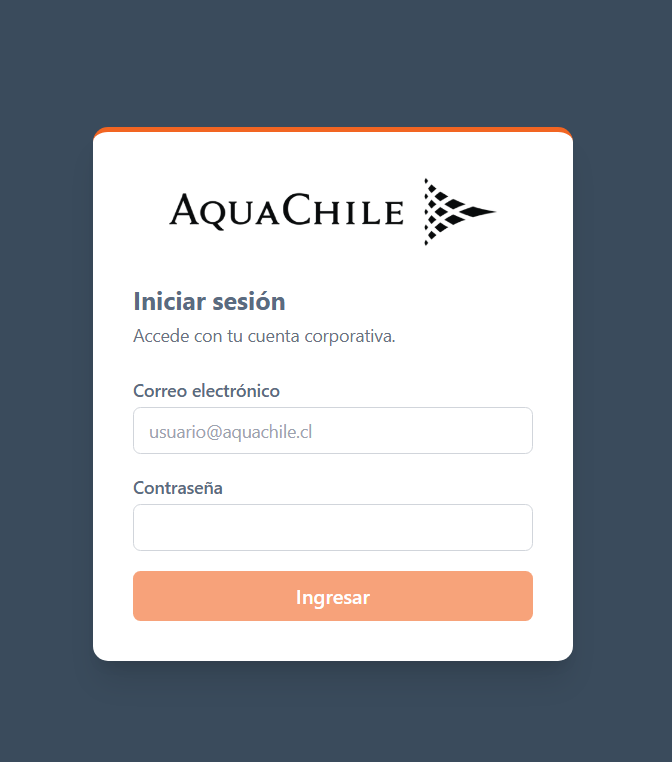
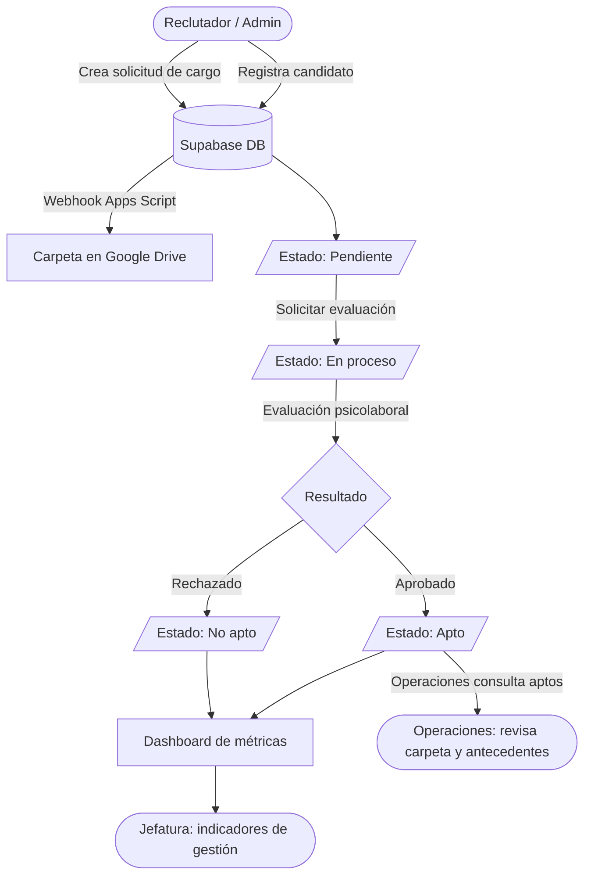

# AquaChile · Gestión y Evaluación Psicolaboral (MVP)


## 🏢 1. Introducción y Guía de Instalación

### ¿Qué es AquaChile y qué resuelve este MVP?

**AquaChile** es una compañía de producción acuícola y salmonera con operaciones desde la Región de Los Lagos hasta Magallanes. Este MVP es una aplicación web de **Gestión y Evaluación Psicolaboral** para el área de Reclutamiento y Selección (R&S).

**Problemática:** el proceso se gestionaba de forma manual y dispersa entre **MS Forms, planillas Excel, Planner y OneDrive**. Eso generaba información duplicada, seguimiento difícil y datos sensibles repartidos en varias herramientas.

**Solución:** una plataforma web **centralizada y segura** que permite:

- Registrar candidatos y solicitudes de cargo en una base de datos única (Supabase).
- Crear automáticamente una carpeta de Google Drive por candidato.
- Seguir el estado de cada candidato (*Pendiente → En proceso → Apto / No apto*).
- Entregar a Operaciones los candidatos aprobados, y a la jefatura indicadores de gestión.
- Controlar el acceso por roles, con restricciones aplicadas también en la base de datos.

### Guía de instalación (computadora nueva)

1. **Requisitos previos:** [Node.js](https://nodejs.org/) **18 o superior**, [Git](https://git-scm.com/) y npm (incluido con Node.js). Para las pruebas se necesita además Google Chrome.
2. **Clonar el repositorio y entrar a la carpeta del frontend:**
   ```bash
   git clone <url-del-repositorio>
   cd frontend
   ```
3. **Instalar dependencias:**
   ```bash
   npm install
   ```
4. **Configurar variables de entorno:** crear el archivo `.env` en la raíz de `frontend/`:
   ```env
   VITE_SUPABASE_URL=https://<tu-proyecto>.supabase.co
   VITE_SUPABASE_ANON_KEY=<tu-anon-key>
   VITE_GOOGLE_DRIVE_WEBHOOK_URL=https://script.google.com/macros/s/<id>/exec
   ```
   > `VITE_GOOGLE_DRIVE_WEBHOOK_URL` es opcional: sin ella el sistema funciona igual, pero no crea carpetas en Drive. El Web App de Apps Script debe estar desplegado con acceso **"Cualquier persona"**.
5. **Preparar la base de datos:** en el SQL Editor de Supabase, ejecutar en este orden:
   1. `docs/schema.sql`
   2. `docs/migracion_estado_candidatos.sql`
   3. `docs/migracion_drive_folder_url.sql`
   4. `docs/migracion_solicitudes.sql`
   5. `docs/politicas_rls_candidatos.sql`
   6. `docs/asignar_roles_usuarios.sql` (asigna el rol de cada usuario en `app_metadata`)
6. **Iniciar el servidor de desarrollo:**
   ```bash
   npm run dev
   ```
   Vite sirve la aplicación en `http://localhost:5173`. Si se edita `.env`, hay que reiniciar este comando.

## 📁 2. Estructura del Proyecto

```text
frontend/
├── README.md
├── index.html
├── package.json
├── vite.config.js
├── tailwind.config.js         # tokens de color aqua-*
├── postcss.config.js
├── eslint.config.js
├── karma.conf.js              # Karma + Jasmine + cobertura
├── docker-compose.yml
├── .env                       # variables VITE_* (no se versiona)
├── public/
│   ├── favicon.svg
│   └── logo-aquachile.png
├── docs/
│   ├── schema.sql
│   ├── migracion_estado_candidatos.sql
│   ├── migracion_drive_folder_url.sql
│   ├── migracion_solicitudes.sql
│   ├── politicas_rls_candidatos.sql
│   ├── asignar_roles_usuarios.sql
│   ├── DOCUMENTO_COBERTURA_TESTING.md
│   ├── HOJA_DE_RUTA_Y_ESPECIFICACIONES_TECNICAS.md
│   └── imagenes/
│       └── login.png
└── src/
    ├── main.jsx
    ├── App.jsx                # rutas y protección por permiso
    ├── index.css
    ├── theme.js
    ├── components/
    │   ├── Layout.jsx         # encabezado, menú, insignia del rol
    │   ├── ProtectedRoute.jsx
    │   ├── LogoAquaChile.jsx
    │   ├── MetricCard.jsx
    │   ├── BarrasHorizontales.jsx
    │   ├── ListaEvaluaciones.jsx
    │   ├── Modal.jsx
    │   ├── Alerta.jsx
    │   ├── BotonIcono.jsx
    │   ├── Iconos.jsx
    │   ├── InsigniaEstado.jsx
    │   ├── InsigniaSolicitud.jsx
    │   └── __tests__/
    ├── context/
    │   ├── AuthContext.jsx    # sesión y rol
    │   ├── permisos.js        # fuente única de roles y permisos (RBAC)
    │   └── __tests__/
    ├── pages/
    │   ├── Login.jsx
    │   ├── Dashboard.jsx
    │   ├── Candidatos.jsx
    │   ├── NuevoCandidato.jsx
    │   ├── Solicitudes.jsx
    │   ├── NuevaSolicitud.jsx
    │   ├── DetalleSolicitud.jsx
    │   ├── DetalleEvaluacion.jsx
    │   └── __tests__/
    ├── services/
    │   ├── supabaseClient.js
    │   ├── candidatosService.js
    │   ├── solicitudesService.js
    │   ├── driveService.js    # Webhook de Google Apps Script
    │   └── __tests__/
    ├── utils/
    │   ├── rut.js             # formateo y validación de RUT (módulo 11)
    │   └── __tests__/
    └── test/
        ├── helpers.jsx
        └── supabaseClientStub.js
```

> Las pruebas viven junto al código, en carpetas `__tests__/`.

## 🛠️ 3. Herramientas y Tecnologías

| Capa | Tecnología | Uso en el proyecto |
| :--- | :--- | :--- |
| **Frontend** | **React 19** + React Router | Interfaz y navegación protegida por permisos |
| | **Vite** | Servidor de desarrollo y compilación de producción |
| | **Tailwind CSS 4** | Estilos y tokens de color corporativos |
| **Backend y nube** | **Supabase Auth** | Inicio de sesión y roles (`app_metadata.rol`) |
| | **Supabase PostgreSQL** | Candidatos y solicitudes |
| | **Row Level Security (RLS)** | Políticas que restringen lectura, edición y borrado en la base |
| | **Supabase Storage** | Almacenamiento de currículums (CV) |
| | **Google Apps Script Webhook** | Crea la carpeta de Google Drive de cada candidato |
| **Calidad** | **Karma** + **Jasmine** | Ejecución de pruebas unitarias en Chrome Headless |
| | React Testing Library | Pruebas de componentes y vistas |
| | ESLint | Análisis estático del código |

## 🎨 4. Paleta de Colores

La identidad visual se define con tokens `aqua-*` en `tailwind.config.js` (fondos y acentos) y se complementa con colores de estado de Tailwind. Se prioriza el alto contraste y la legibilidad: fondos claros, texto oscuro y un único color de acción.

| Token | Color | Uso |
| :--- | :--- | :--- |
| `aqua-blue` | `#5A6B81` | Títulos, texto principal y bordes de botones secundarios |
| `aqua-dark` | `#3A4B5C` | Encabezado y pie de página |
| `aqua-orange` | `#F26522` | Acción principal: botones, pestañas activas y acentos |
| `aqua-light` | `#FBF9F6` | Fondo general de la aplicación |
| Blanco / grises (`slate`) | `#FFFFFF` y escala gris | Tarjetas, tablas, bordes y texto secundario |

**Colores de estado** (siempre con ícono y texto, no solo color):

| Estado | Color |
| :--- | :--- |
| Pendiente / Abierta | Naranja suave |
| En proceso | Azul suave |
| Apto | Verde |
| No apto | Rojo |
| Cerrada | Gris |

> Nota: `src/theme.js` conserva la paleta oscura original, que solo usan algunas pantallas heredadas. El resto de la interfaz usa los tokens de `tailwind.config.js`.

## 🖼️ 5. Previsualización del Sistema

Pantalla de inicio de sesión:



Ver archivo: [`docs/imagenes/login.png`](docs/imagenes/login.png)

## 👥 6. Control de Acceso y Roles (RBAC)

| Rol | Correo | Contraseña | Permisos |
| :--- | :--- | :--- | :--- |
| **Administrador** | `admin@aquachile.cl` | `AquaAdmin#2026_Secure` | Acceso total: ver Inicio, solicitudes y candidatos; crear y editar; evaluar; **eliminar candidatos (exclusivo admin)** y configuración. |
| **Reclutador** | `reclutador@aquachile.cl` | `AquaReclut#2026_Secure` | Crea y edita candidatos y solicitudes, solicita y registra evaluaciones, con creación automática de carpeta en Drive. **No elimina.** |
| **Operaciones** | `operaciones@aquachile.cl` | `AquaOps#2026_Secure` | **Solo lectura.** Ve el Inicio con los *Aptos listos para incorporación*, solicitudes y candidatos (por defecto filtrados a *Apto*, con selector *Todos / Solo Aptos*). Sin crear, editar, evaluar ni eliminar. |

> ⚠️ Estas credenciales son de demostración para el MVP. En un entorno real deben cambiarse y no publicarse en el repositorio.

**Matriz de permisos**

| Acción | Admin | Reclutador | Operaciones |
| :--- | :---: | :---: | :---: |
| Ver Inicio, Solicitudes y Candidatos | ✅ | ✅ | ✅ |
| Crear candidato y solicitud | ✅ | ✅ | ❌ |
| Editar candidato | ✅ | ✅ | ❌ |
| Solicitar y registrar evaluación | ✅ | ✅ | ❌ |
| Eliminar candidato (con confirmación escribiendo el nombre) | ✅ | ❌ | ❌ |

**Cómo funciona:** el rol se lee de `app_metadata.rol` en Supabase Auth, un campo que solo puede escribir el backend. En el frontend, `src/context/permisos.js` es la fuente única de permisos: las rutas (`ProtectedRoute`), el menú y los botones consultan permisos y no nombres de rol. El encabezado muestra el rol de la sesión con un ícono de usuario. En la base de datos, las políticas RLS validan cada operación (por ejemplo, el borrado exige `rol = admin`), de modo que la restricción no depende solo de la interfaz.

## 🧪 7. Pruebas Unitarias y Calidad

El proyecto cuenta con **152 pruebas unitarias** que pasan en verde, ejecutadas con **Karma + Jasmine** y React Testing Library. Cubren páginas, componentes, servicios, validación de RUT y el control de roles (incluido el filtro de Operaciones, el borrado con confirmación y el caso en que una falla de Google Drive no impide registrar al candidato).

| Comando | Descripción |
| :--- | :--- |
| `npm test` | Ejecuta las 152 pruebas unitarias en Chrome Headless y genera la cobertura. |
| `npm run lint` | Análisis estático con ESLint (0 errores y 0 advertencias). |
| `npm run build` | Compilación de producción con Vite. |

## 🔄 8. Diagrama de Flujo del Proyecto


