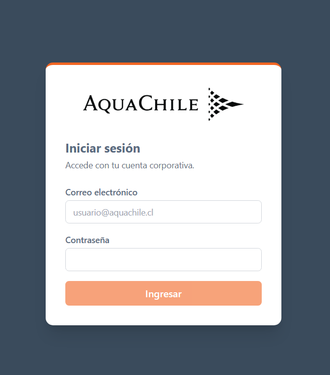
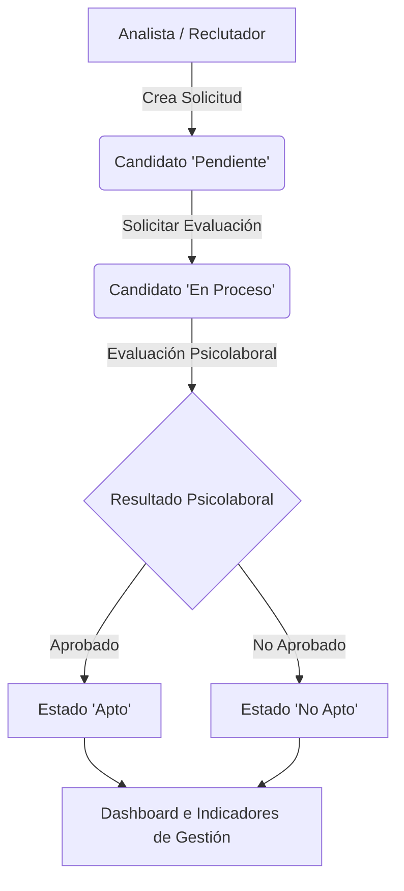

# AquaChile · Gestión y Evaluación Psicolaboral (MVP)


## 🏢 1. Introducción, Problema y Guía de Instalación Inicial

### Introducción

**AquaChile** es una compañía de producción acuícola y salmonera con operaciones desde la Región de Los Lagos hasta Magallanes. Este MVP es una aplicación web de **Gestión y Evaluación Psicolaboral** de candidatos, pensada para acompañar al equipo de Reclutamiento y Selección durante todo el proceso: desde el registro del candidato hasta el resultado de su evaluación.

### Contexto y problemática

La contraparte del proyecto es **María Victoria Bustamante**, del área de **Reclutamiento y Selección (R&S)**. Hoy el proceso se lleva de forma manual y dispersa entre **MS Forms, planillas Excel, Planner y OneDrive**, lo que dificulta el seguimiento, duplica información y expone datos sensibles.

El MVP resuelve esto con un **sistema centralizado, intuitivo y seguro**: una única fuente de verdad en base de datos, estados claros por candidato, indicadores de gestión y acceso controlado por roles.

### Guía de instalación (equipo nuevo)

1. **Requisitos previos:** [Node.js](https://nodejs.org/) v18 o superior, [Git](https://git-scm.com/) y npm (incluido con Node.js).
2. **Clonar el repositorio y entrar a la carpeta del frontend:**
   ```bash
   git clone https://github.com/donMixho/AquaChile.git
   cd frontend
   ```
3. **Instalar dependencias:**
   ```bash
   npm install
   ```
4. **Configurar variables de entorno:** crea el archivo `.env` en la raíz de `frontend/` con:
   ```env
   VITE_SUPABASE_URL=https://<tu-proyecto>.supabase.co
   VITE_SUPABASE_ANON_KEY=<tu-anon-key>
   ```
5. **Iniciar el servidor de desarrollo:**
   ```bash
   npm run dev
   ```

> La estructura de tablas está en `docs/schema.sql` y las políticas de seguridad en `docs/politicas_rls_candidatos.sql`.

## 📁 2. Estructura del Proyecto

```text
frontend/
├── README.md
├── index.html
├── karma.conf.js
├── package.json
├── vite.config.js
├── tailwind.config.js
├── docs/
│   ├── schema.sql
│   ├── politicas_rls_candidatos.sql
│   └── imagenes/
│       └── login.png
└── src/
    ├── App.jsx
    ├── main.jsx
    ├── components/
    ├── context/
    │   ├── AuthContext.jsx
    │   └── permisos.js
    ├── pages/
    │   ├── Dashboard.jsx
    │   ├── Candidatos.jsx
    │   ├── Solicitudes.jsx
    │   ├── DetalleEvaluacion.jsx
    │   └── ...
    ├── services/
    │   ├── supabaseClient.js
    │   └── candidatosService.js
    └── theme.js
```

## 🛠️ 3. Herramientas y Tecnologías Utilizadas

| Capa | Tecnologías |
| :--- | :--- |
| **Frontend** | React 19, Vite, Tailwind CSS, React Router |
| **Backend y persistencia** | Supabase: Auth, base de datos PostgreSQL, Storage y Row Level Security (RLS) |
| **Pruebas y calidad** | Karma, Jasmine, React Testing Library, ESLint |

## 🎨 4. Paleta de Colores

La interfaz utiliza los **tokens visuales definidos en `src/theme.js`**, basados en la paleta oficial de AquaChile: **Azul Corporativo**, **Verde Marino**, **Grises Neutros** y **Acentos de Estado** (por ejemplo, verde para *Apto*, rojo para *No Apto* y ámbar para *En proceso*). Centralizar los colores en un solo archivo da una experiencia familiar e institucional y permite ajustar la identidad visual sin tocar cada pantalla.

## 🖼️ 5. Previsualización del Sistema (Login)



## 👥 6. Control de Acceso y Roles (RBAC)

| Rol | Usuario / Correo | Contraseña | Permisos y Capacidades |
| :--- | :--- | :--- | :--- |
| **Administrador** | `admin@aquachile.cl` | `AquaAdmin#2026_Secure` | Acceso total: crear, editar, evaluar y eliminar candidatos (papelera exclusiva), más configuración. |
| **Reclutador** | `reclutador@aquachile.cl` | `AquaReclut#2026_Secure` | Acceso operativo completo: crear, editar y evaluar candidatos y solicitudes. Sin permiso de borrado. |
| **Operaciones** | `operaciones@aquachile.cl` | `AquaOps#2026_Secure` | Solo lectura: consulta de Dashboard, Candidatos y Solicitudes. Creación y edición bloqueadas. |

> Las credenciales son sintéticas y solo para pruebas.

**Cómo funciona:** el rol se lee de `app_metadata.rol` en Supabase Auth, un campo que solo puede escribir el backend (el usuario no puede modificarlo). En el frontend, `src/context/permisos.js` es la fuente única de permisos: las rutas (`ProtectedRoute`), el menú y los botones consultan permisos, no nombres de rol. En la base de datos, las políticas RLS de PostgreSQL validan cada operación, de modo que la restricción no depende solo de la interfaz.

## 🧪 7. Pruebas Unitarias y Calidad de Código

El proyecto cuenta con **113 pruebas unitarias** ejecutadas con **Karma + Jasmine** y React Testing Library.

| Comando | Descripción |
| :--- | :--- |
| `npm test` | Ejecuta la suite de pruebas unitarias. |
| `npm run lint` | Verificación estática de código con ESLint. |
| `npm run build` | Compilación de producción. |

## 🔄 8. Flujo de Trabajo del Proyecto


